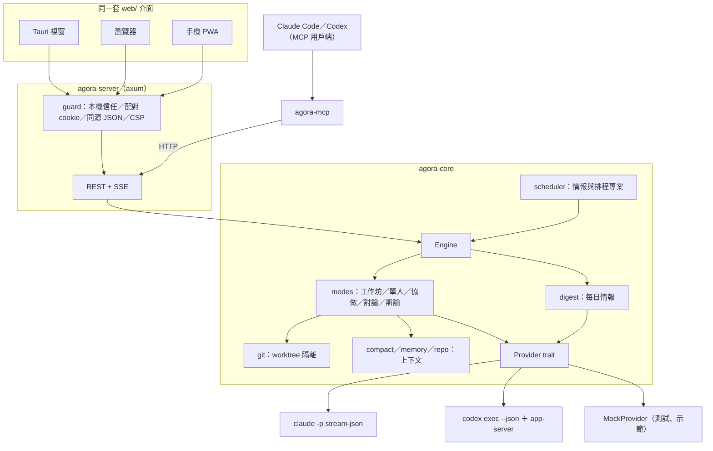

# Architecture

Agora 是一個 Rust 引擎，加上一個內嵌的 HTTP 伺服器，外面再包一層 Tauri 視窗。

- 引擎透過 CLI 驅動 Claude Code 與 Codex，所以它們就是在你的訂閱、你的程式庫資料夾裡真正能動手的 agent。
- 伺服器把同一個引擎同時提供給桌面視窗、瀏覽器、手機，以及 MCP 用戶端。

各子系統的細節在 [docs/tech/](docs/tech/README.md)；這份文件只講**為什麼**這樣切。

## 設計原則

1. **只走 CLI 訂閱，計費防護寫在程式碼裡**（[ADR 0001](docs/adr/0001-cli-only-never-paid-api.md)）：
   - 啟動前清除環境變數；
   - 檢查 Claude 的 `apiKeySource`；
   - 確認 Codex 的帳號類型；
   - 無法確認時不執行（fail closed）。
2. **先討論、人核准、再實作**（[ADR 0003](docs/adr/0003-workshop-approval-gate.md)）。最花額度、最有風險的實作階段，一定排在人的判斷之後。
3. **寫入要隔離，套用由人決定**（[ADR 0004](docs/adr/0004-worktree-without-commits.md)）。模型在 git worktree 裡改檔；Agora 從不替你 commit。
4. **成本一定有上限**：發言上限（硬上限 24）、修訂上限、方案修訂上限（2 次），以及在呼叫前就攔下的額度保護與改派。到達上限時交付目前的結果並記錄原因。
5. **不默默丟資料**：記憶壓縮、記憶檢索、防護觸發、改派、被拒的模型、失敗的情報來源，全部留下紀錄。
6. **證據等級由程式決定上限**：沒有驗證指令通過就不會是「已確認」；只靠模型判斷的結論，最高「推論」。
7. **一個伺服器、所有介面**（[ADR 0002](docs/adr/0002-rust-core-embedded-http-tauri-shell.md)）。手機一定要走 HTTP，所以桌面也走 HTTP，只維護一套前端；頁面沒有 Tauri IPC。
8. **agent 拿不到你的個人工具**：預設隔離 CLI 的個人 MCP、外掛和 hooks（[lessons/0007](docs/lessons/0007-cli-personal-config-leaks-into-agent-runs.md)）。
9. **衍生狀態從來源對帳，不靠事件**（v0.5）：專案團隊的每個階段就是一個 plan-only 工作坊專案；工作流的階段狀態每次讀取、開始、啟動、專案變化時都從專案紀錄重新推導（冪等），所以漏掉一個事件或中途重啟都不會讓兩者不一致（[14](docs/tech/14-team-workflow.md)）。
10. **審查結論由程式判定**（v0.6，參考 review-bridge）：驗收條件在核准時由程式切出並封存；審查者逐條回覆、附證據，程式拒收不完整或沒證據的回覆；版本指紋確認審查的就是驗證的那一版；方法論（skill）由 Agora 依階段確定性注入並留下收據（[15](docs/tech/15-review-and-skills.md)）。
11. **離線可測**：`MockProvider` 是確定性的。五種模式、核准關卡、worktree、情報整理、信任模型、MCP，都能在不呼叫 CLI、不花額度的情況下測試。

## 模組對照

| 關注點 | 模組 | 文件 |
|---|---|---|
| 專案排程、成本上限、額度保護與改派、插話、分岔、盲審 | `engine/{mod,runner}.rs` | [02](docs/tech/02-engine-and-modes.md) |
| 五種模式與核准關卡 | `engine/modes.rs`、`engine/ops.rs::decide` | [02](docs/tech/02-engine-and-modes.md) |
| CLI 驅動與計費防護 | `provider/{claude,codex,proc,stream,resolve}.rs` | [03](docs/tech/03-providers-and-billing-guard.md) |
| worktree 隔離、diff、套用 | `git.rs`、`engine/ops.rs` | [04](docs/tech/04-workspace-isolation.md) |
| 每日技術情報 | `digest/{sources,rank,mod}.rs`、`scheduler.rs` | [05](docs/tech/05-daily-digest.md) |
| 額度、歷史、統計 | `quota.rs`、`history.rs` | [06](docs/tech/06-quota-and-usage.md) |
| 記憶壓縮、檢索記憶、程式庫快照 | `compact.rs`、`memory.rs`、`repo.rs`、`prompts.rs` | [07](docs/tech/07-memory-and-context.md) |
| 信任模型 | `agora-server/src/{auth,lib,v2}.rs` | [08](docs/tech/08-security-model.md) |
| 範本、匯出（ADR、lesson、Markdown） | `templates.rs`、`export.rs` | [10](docs/tech/10-data-model.md) |
| 專案團隊（名冊、階段計畫、對帳、任務交付、匯出） | `team.rs`、`engine/team_ops.rs`、`engine/modes.rs::team_stage`、`agora-server/src/team_api.rs` | [14](docs/tech/14-team-workflow.md) |
| 助理聊天（角色人設可由本機擴充替換） | `engine/assistant.rs`；本機擴充的載入見 `agora-server/src/lib.rs::local_extensions`、`web/js/main.js::loadExtensions` | [09](docs/tech/09-api-reference.md) |
| 驗收合約、兩階段審查、版本指紋、唯讀證明 | `review.rs`、`engine/modes.rs::plan_build_loop`、`git.rs::fingerprint`、`engine/ops.rs::prove_readonly` | [15](docs/tech/15-review-and-skills.md) |
| Serendipity skill 登錄、對應、注入 | `skills.rs`、`harness/se/` | [15](docs/tech/15-review-and-skills.md) |
| 介面 | `web/js/*.js`、`web/app.css` | [11](docs/tech/11-frontend.md) |
| 桌面外殼、MCP server | `src-tauri/src/main.rs`、`agora-server/src/bin/agora-mcp.rs` | [12](docs/tech/12-desktop-mobile-mcp.md) |

## 刻意不做的事

- **任何 API key 路徑**，即使是「選用」也不做。
- **替使用者 commit**：只產生未 commit 的修改，判斷交給人。
- **自動續跑中斷的專案**：重啟時標記為中斷，由人決定要不要重開；只有等待核准的專案會保留下來，可以之後再核准。
- **在 MCP 裡寫入**：透過 MCP 開的專案一律唯讀，工作坊只產出方案。
- **前端框架或建置步驟**：零相依性、`script-src 'self'` 是刻意的選擇。
