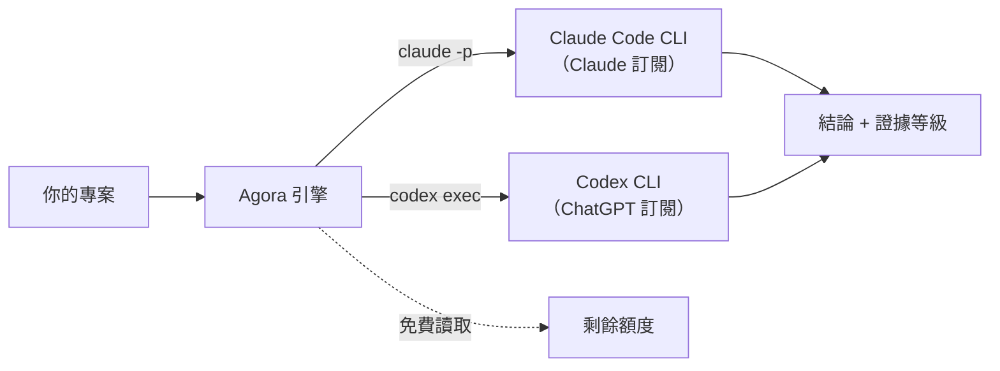

<div align="center">


# Agora

**One question. Two minds. Clear answers.**

讓 Claude 與 GPT 單獨作答、協做、討論或辯論的多模型協作平台。
桌面 exe、網頁、手機是同一套介面；**只用你自己的 CLI 訂閱額度，絕不使用付費 API key。**

</div>

---

## v0.6 重點：可稽核的審查、Serendipity skill

- **審查結論由程式判定**（參考 [review-bridge](https://github.com/fortes1219/review-bridge)）：方案核准時，驗收條件被切成 AC1…ACn 並封存；實作後先做**規格審查**（逐條判定，通過一定要有證據），全部通過才做**品質審查**。缺條件、沒證據、版本對不上的審查回覆一律不算數。專案頁直接看得到每一條的判定與證據。
- **版本指紋**：驗證前、交給審查者前、審查後各取一次 git 指紋；審查期間工作區有變動，那次審查就作廢。
- **唯讀證明**：設定頁可以實際證明審查者寫不進檔案；沒證明過的，結論最高只到「推論」。
- **Serendipity skill**：使用者自己的 harness [Serendipity-Epiphany](https://github.com/cdexswzaq0110/Serendipity-Epiphany) 升級為 v2.0.0——9 個核心 skill（Agent Skills 標準，Claude Code 與 Codex 共用）。Agora 依團隊階段與工作坊步驟**自己注入**對應的 skill（不靠 CLI 自動觸發），每則發言都記錄用了哪個 skill；Skills 頁看得到版本、驗證狀態與使用次數。[Serendipity-Epiphany-Codex](https://github.com/cdexswzaq0110/Serendipity-Epiphany-Codex) 改為從同一份來源同步 skill。
- **用語**：「議題」改叫**專案**；原本的「專案」（工作資料夾）改叫**程式庫**。
- 設計、互評與紅隊：[docs/design/2026-11-17-v0.6](docs/design/2026-11-17-v0.6/05-final-plan.md)；技術說明：[docs/tech/15](docs/tech/15-review-and-skills.md)；驗收清單：[docs/ACCEPTANCE.md](docs/ACCEPTANCE.md)；Skill 使用說明：[docs/SKILLS.md](docs/SKILLS.md)。

## v0.5 重點：專案團隊

- **專案團隊**（導覽「團隊」）：寫下一個構想，由 PM、UX、SA、Architect、SD、DBA、Dev、QA、DevOps/SRE、LLM、NLP、AI、系統設計師、系統架構師、資料分析師、ML、MLOps、DL 共 18 個角色，分五個階段替你做事：**構想收斂 → 可行性分析 → 需求與體驗 → 技術設計 → 任務拆分**。每個階段都停下來等你核准；可行性分析可以直接決定「不做」。任務清單核准後，每一項可以一鍵交給方案工作坊實作。
- **成本看得見**：快速 5 次、標準 9 次（AI 類 11 次）模型呼叫；開始前顯示，超過工作流上限要你確認。每個角色都留下「完整／簡查／不適用」紀錄，缺席的角色標成「缺漏」，不會假裝通過。
- 上游文件改版時，依據舊版的下游文件自動標成「已過期」；重複點擊不會多開專案；文件可以匯出到專案的 `docs/agora/`。設計與紅隊修訂：[docs/design/2026-11-16-v0.5](docs/design/2026-11-16-v0.5/05-final-plan.md)；技術說明：[docs/tech/14](docs/tech/14-team-workflow.md)。
- **動態效果與命令面板**（GPT 實作）：參考 [cdexswzaq0110.github.io](https://cdexswzaq0110.github.io/) 的動態語彙；Ctrl／⌘＋K 開命令面板；設定可選自動／開／關，降低動態時全部停用。
- **本機擴充**：個人的內容（例如自己的桌寵角色、助理人設）放在 本機擴充（`web/local/`，git 忽略，只在自己的電腦）；公開的 repo 與 Release 不包含它們，只有通用的助理聊天 API。
- **Tailscale**：讀取實際的 `tailscale serve` 設定，只在空的連接埠（443／8443／10000）加上 Agora，不覆蓋你已有的服務。

## v0.4 重點

- 一樣先讓 Claude 與 GPT 提案、互評、紅隊審視再實作（[docs/design/2026-11-16-v0.4](docs/design/2026-11-16-v0.4/05-final-plan.md)）；手機 QR 連線則直接**分派給 GPT 實作**，Claude 審查後合併。
- **推理強度可調**：每位參與者都能選 low…max（依模型實際支援的值；Codex 讀它自己的模型清單、Claude 讀 `--help`），伺服器會擋下不支援的值。
- **情報對照昨天**：新上榜、升溫（同來源同指標 +30% 且 +10 以上）、連續上榜天數、關注主題的變化；不多花任何模型呼叫。導覽列有未讀點，手機讀過電腦也算讀過。
- **方案段落留言**：核准前可以對方案的某一段留言，修訂時逐條送給總結者。結論會建議一句「存入程式庫記憶」，你可以改了再存。
- 手機底部導覽、鍵盤快捷鍵（`?` 看全部，可關閉）、情報／用量／設定三頁重整（目錄、未儲存提醒）。
- 修正：隔離 CLI 個人設定後，Codex 實作者其實寫不進檔案（[lessons/0011](docs/lessons/0011-isolating-cli-config-dropped-codex-write-sandbox.md)）。

## v0.3 重點（介面）

- 先讓 Claude 與 GPT 各自提案、互評、整合，GPT 再紅隊審視，然後才實作：過程全文在 [docs/design/2026-11-16-ui-v0.3](docs/design/2026-11-16-ui-v0.3/05-final-plan.md)。
- **首頁工作台**：第一個畫面就能寫專案；頂部的待辦列與導覽徽章告訴你哪個方案在等你核准；一行流程摘要說清楚會發生什麼。
- **專案頁先看成果**：核准面板是「方案文件＋固定的決策欄」；討論依輪收合，每則發言留一行摘要；側欄有階段目錄。
- 鍵盤操作、ARIA 語意與 `aria-live` 宣告、手機 44px 觸控、深色主題都在瀏覽器量測過（還沒用實際的螢幕閱讀器測）；示範模式現在預設只用模擬模型。

## v0.2 重點

- **方案工作坊**（預設模式）：獨立提案 → 互評 → 整合成有驗收標準的方案 →（紅隊）→ **你核准** → 在 git worktree 實作 → 驗證 → 依驗收標準審查 → 你看 diff 再決定套用。
- **每日技術情報**：每天整理 Hacker News、GitHub Trending、Lobsters、Reddit、dev.to、Hugging Face Papers 的熱門項目，產出附來源編號的繁體中文摘要。
- 另有專案範本、ADR 與 lesson 匯出、額度不足時自動改派、分岔、盲審、檢索式記憶、模式比較、排程專案、QR 配對、語音輸入、用量圖表、MCP server。
- 文件：[技術文件](docs/tech/README.md)、[開發日誌](docs/devlog/README.md)、[講解指南](docs/tech/presentation-guide.md)。

## 用手機連線

電腦上的 Agora 頁尾有「手機連線」，那裡有逐步說明、QR code 和 6 位數配對碼。

**出門也能用：Tailscale（建議，HTTPS，可以安裝成 App、收通知）**

1. 手機安裝 Tailscale App，登入和電腦**同一個帳號**，打開 App 裡的連線開關。
2. 電腦也要安裝並登入 Tailscale；在 Agora 的「手機連線」按「啟用 Tailscale 連線」。只會新增一個 HTTPS 連接埠，不會覆蓋你已有的 `tailscale serve` 設定。
3. 手機相機掃 QR code（或用 Safari／Chrome 打開顯示的 `https://<電腦名稱>.<tailnet>.ts.net…` 網址）。
4. 輸入配對碼（掃 QR 會自動帶入；10 分鐘內有效）。
5. iPhone：Safari 分享 →「加入主畫面」；Android：Chrome 選單 →「安裝應用程式」。

**在家：同一個 Wi‑Fi**：在「手機連線」勾選允許區網，Windows 防火牆詢問時在「私人網路」按「允許」，再掃 QR code、輸入配對碼。區網是 HTTP，不能安裝成 App。

打不開時：確認手機的 Tailscale 開關是開的、兩邊是同一個帳號；區網則確認同一個 Wi‑Fi、防火牆已允許，並在網卡清單裡選實體網卡（不要選 vEthernet、WSL、VMware）。

## 這個程式庫在解什麼問題

做專案時，常常想讓兩個模型各看一次、互相挑錯，或者正反方吵一架再下結論。但手動在兩個 CLI 之間複製貼上很累，也看不出還剩多少額度。

Agora 把 **Claude Code CLI** 與 **Codex CLI** 當成兩位成員，用四種固定的協作方式排程它們。每個專案都有成本上限，每個結論都附上[證據等級](#證據等級)。



## 四種協作方式

| 模式 | 流程 | 適合 |
|---|---|---|
| **單人** | 一個模型直接回答或動手做 | 快速問答、小修改 |
| **協做** | 執行者 →（驗證指令）→ 審查者 → 不通過就修訂，修訂次數有上限 | 寫程式、修 bug；可以讓 Claude 寫、GPT 審，或反過來 |
| **討論** | 第一輪各自**獨立**作答（避免互相帶風向）→ 互相回應 → 總結共識與分歧 | 技術選型、架構方向 |
| **辯論** | 正反方攻防 → 雙方模型**交叉裁判**；裁判意見不一致就直接標示分歧 | 需要逼出風險和反例的決策 |

執行中可以隨時**插話**（下一則發言起生效），也可以**停止**。

## 絕不使用付費 API key

這是硬性規則，不是設定選項（[ADR 0001](docs/adr/0001-cli-only-never-paid-api.md)）。下面三層防護都有測試：

1. 啟動 CLI 前，清除 `ANTHROPIC_API_KEY`、`OPENAI_API_KEY`、`CODEX_API_KEY`、Bedrock／Vertex 等所有會改走付費 API 的環境變數。
2. **Claude**：`claude -p` 的第一行回報 `apiKeySource`。只要不是 `none`，就在模型回答之前終止程序。
3. **Codex**：每一輪開始前，先透過 `codex app-server` 確認登入方式是 `chatgpt`。是 `apiKey`，或者無法確認，就不執行（fail closed）。

## 用量儀表

| | 來源 | 花費 |
|---|---|---|
| **GPT（Codex）** | `codex app-server` 的 `account/rateLimits/read`：5 小時窗、每週窗的已用比例與重置時間 | 免費，每 5 分鐘自動更新 |
| **Claude** | 每次 `claude -p` 執行時附帶的 `rate_limit_event`（5 小時窗、每週窗） | 免費，跑過一次就有數字；也可以手動「主動更新」（用極少額度） |

頂部列、用量頁，以及桌面版可置頂的**用量小工具**，都用 5 格 HP 條顯示剩餘額度。任一時段用到門檻（預設 97%）時，**額度保護**會拒絕再呼叫該模型。

## 記憶與驗證

- **記憶壓縮**：每則發言都會帶入前面的討論。超過門檻（預設 24,000 字）時，最近的發言保留原文，較早的發言改成擷取式摘要，並加上看得見的標記。全文一律保留在紀錄裡。
- **程式庫記憶**：專案結束後按「存入程式庫記憶」，結論會變成一行決策紀錄，之後每個專案都會帶入（超過 3,000 字自動摘要）。
- **驗證流程**：單人和協做模式可以設定驗證指令，例如 `cargo test`。驗證失敗時，結果會回饋給審查者和執行者。

### 證據等級

沿用 [Serendipity-Epiphany](https://github.com/cdexswzaq0110/Serendipity-Epiphany) 的五級制，由程式強制套用，不是交給模型自己評：

| 結論 | 等級 |
|---|---|
| 協做：審查通過**且**驗證指令通過 | 已確認 |
| 協做：審查通過，但沒有設定驗證指令 | 推論 |
| 協做：到達修訂上限仍有問題 | 候選 |
| 驗證指令失敗 | 未驗證 |
| 討論／辯論的結論 | 最高「推論」（沒有直接觀察，就不能是「已確認」） |
| 辯論裁判意見分歧 | 候選 |
| 單人、沒有驗證 | 未驗證 |

## 快速開始

**需求**：Windows 10/11（內建 WebView2）、Rust 1.80+，以及已經用**訂閱帳號**登入的兩個 CLI：

```bash
claude auth login
```

```bash
codex login
```

**網頁版**（不開視窗，適合常駐）：

```bash
cargo run -p agora-server --release
```

打開 <http://127.0.0.1:4717/>。想先不花任何額度看看介面，可以加 `-- --demo`，會多出兩個離線模擬模型。

**桌面版**：不想自己編譯的話，到 [Releases](https://github.com/cdexswzaq0110/Agora/releases) 下載 `Agora_<版本>_x64-setup.exe` 安裝（沒有程式碼簽章，Windows 會跳出 SmartScreen：「其他資訊」→「仍要執行」）。自己編譯：

```bash
cargo build -p agora-desktop --release
```

產出 `target/release/agora-desktop.exe`。要做成安裝檔（NSIS），先 `cargo install tauri-cli --version "^2"`，再在 `src-tauri/` 執行 `cargo tauri build`。

**手機**：桌面版的「設定 → 手機連線」會顯示 6 位數配對碼。

- 同一個 Wi-Fi：勾選「允許區網連線」，手機打開畫面上的區網網址。
- 出門在外：在電腦執行 `tailscale serve --bg 4717`，手機打開 `https://<電腦名稱>.<tailnet>.ts.net/`。走 HTTPS 才能安裝成 App，也才能收到通知。

## 結構

```text
crates/agora-core/     引擎：CLI 提供者、四種模式、用量、記憶壓縮、驗證、儲存（無 UI 相依）
  src/provider/          claude.rs · codex.rs · mock.rs · proc.rs（環境清理）· resolve.rs · stream.rs
  src/engine.rs          專案排程、成本上限、額度保護、插話、取消
  tests/engine_modes.rs  四種模式的端到端測試（模擬提供者，不花額度）
crates/agora-server/   HTTP + SSE 伺服器與信任模型；內嵌 web/；也是無視窗版的執行檔
src-tauri/             Tauri 桌面殼：主視窗、系統匣、置頂用量小工具、原生通知
web/                   原生 HTML/CSS/JS（無建置步驟），github.io 風格，PWA
docs/adr/              架構決策
docs/lessons/          實際踩過的坑（附失敗證據）
ROADMAP.md             後續發想與優先順序
```

## 開發

```bash
cargo test --workspace
```

設計理由與模組對照見 [ARCHITECTURE.md](ARCHITECTURE.md)；共用詞彙見 [CONTEXT.md](CONTEXT.md)；接下來要做什麼見 [ROADMAP.md](ROADMAP.md)。

## 與其他作品的關係

- **[Serendipity-Epiphany](https://github.com/cdexswzaq0110/Serendipity-Epiphany)**：證據等級、lessons／ADR 的寫法、核心規則。
- **[Agent Kernel](https://github.com/cdexswzaq0110/Agent-System-Design)**：「審查機制必須限制自身成本」（其 ADR 0002）、上下文壓縮與「不默默丟資料」的原則。
- **Codex Usage Companion**：5 格 HP 條的用量呈現方式，以及從 Codex app-server 讀額度的作法。

## License

MIT — 見 [LICENSE](LICENSE)。
