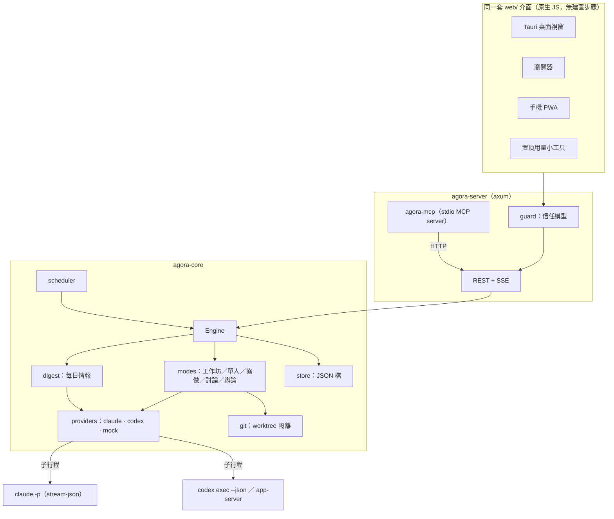

# 01 · 系統總覽

## 一句話

Agora 讓 **Claude Code CLI** 和 **Codex CLI** 像兩位工程師一樣合作：先各自提案、互相挑錯，整合出更好的方案；你核准之後，才在隔離的 git 分支實作、跑驗證，再依驗收標準審查。全程使用你自己的訂閱，不使用付費 API key。另外，它每天會整理一份國外技術社群的熱門摘要給你。

## 組成

| crate／資料夾 | 角色 | 約略行數 |
|---|---|---|
| `crates/agora-core` | 引擎與全部商業邏輯；不依賴任何 UI | 約 7,500 行 Rust |
| `crates/agora-server` | HTTP、SSE、信任模型、內嵌網頁；無視窗版執行檔；`agora-mcp` | 約 1,700 行 Rust |
| `src-tauri` | 桌面外殼 | 約 200 行 Rust |
| `web/` | 介面（12 個 ES module） | 約 2,800 行 JS／CSS／HTML |

## 一個議題的一生（以方案工作坊為例）

1. 你在首頁選模式、參與者、寫議題，按下開始 → `POST /api/sessions`。
2. `Engine::start` 驗證規格、算出發言上限、存檔、建立 `Runner`，在背景執行。
3. 頁面打開 `GET /api/sessions/{id}/events`（SSE）：先收到一份完整快照，之後是即時事件。
4. 每一則發言（`Runner::turn`）：
   1. 額度保護：快用完時改派給另一個模型，或直接拒絕。
   2. 組提示詞：角色指令、專案記憶（檢索）、專案快照、議題、前面的發言（必要時記憶壓縮）、你的插話。
   3. 啟動 CLI 子行程，從 stdin 送入提示詞；把串流文字、工具呼叫、額度事件即時轉成 SSE。
5. 工作坊走到核准關卡時暫停（`awaiting_approval`），等你核准、要求修訂或只保留方案。
6. 核准後建立 git worktree，執行者在裡面改檔 → 驗證指令 → 審查者依驗收標準打勾 → 有上限的修訂。
7. 寫入結論（含證據等級）。你檢查 diff 後，決定「套用到專案」或「丟棄」。

## 五個貫穿全專案的原則

| 原則 | 在哪裡落實 |
|---|---|
| **只走 CLI 訂閱** | 三層計費防護（[03](03-providers-and-billing-guard.md)、ADR 0001） |
| **成本一定有上限** | 發言上限、修訂上限、方案修訂上限、額度保護（[02](02-engine-and-modes.md)） |
| **人做關鍵決定** | 核准關卡、套用或丟棄、寫成 ADR 都要按鈕（ADR 0003、0004） |
| **不默默丟資料** | 記憶壓縮、防護觸發、改派、被拒的模型，全部記在過程紀錄 |
| **證據等級由程式決定上限** | 沒有驗證指令通過，就不會是「已確認」 |
