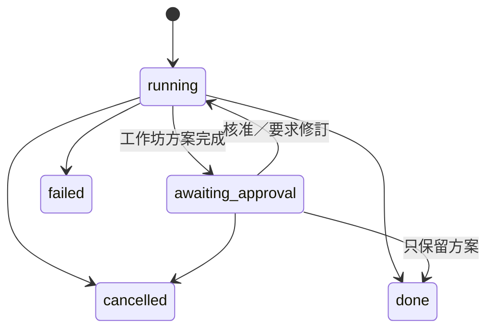

# 02 · 引擎與五種協作模式

原始碼：`crates/agora-core/src/engine/`（`mod.rs` 是引擎本體，`runner.rs` 是發言的基本操作，`modes.rs` 是各模式，`ops.rs` 是專案以外的操作）。

## 基本操作（`runner.rs`）

| 操作 | 作用 |
|---|---|
| `turn(plan, visible)` | 一則發言。`visible` 決定這則發言能看到前面幾則；同一輪的平行發言共用同一個值，所以彼此看不到。 |
| `parallel(plans)` | 用 `JoinSet` 同時跑多則發言，結果依原順序回傳。 |
| `verify(cmd, round)` | 在目前的工作目錄（可能是 worktree）執行驗證指令。 |
| `await_gate()` | 進入 `awaiting_approval` 狀態，等 `oneshot` 收到 `GateDecision`；可以被取消。 |
| `ensure_workspace()` | 第一次要寫入之前，建立 worktree（或改用直接寫入），並記錄原因。 |
| `set_phase` / `set_plan` / `set_verdict` / `note` | 更新紀錄、存檔、送出對應的 SSE 事件。 |

每則發言開始前依序檢查：是否已取消 → 是否超過發言上限 → 額度保護（可能改派）。

## 五種模式

### 方案工作坊（`workshop`，預設）

```
第 1 輪  提案者 ×n（平行、獨立）         ask_planner
第 2 輪  評論者 ×n（平行）               ask_critic：優缺點、評分表、推薦的組合
第 3 輪  總結者                          ask_plan_synthesis：提案評分＋最終方案（含驗收標準）
第 4–5 輪（選用）紅隊 → 總結者修訂       ask_red_team、ask_plan_revise
★ 核准關卡                               approval_loop：Approve ／ Revise（≤2）／ Reject
第 6 輪起 執行者（可寫）→ 驗證 → 審查者    ask_build_from_plan、ask_review_against_plan
          有上限的修訂迴圈（rounds，預設 1，最多 3）
```

- **方案擷取**：`prompts::extract_plan` 取「## 最終方案」標題之後到文末的內容，去掉 `整體證據等級`、`VERDICT` 這類尾行。
- **執行者與審查者**：預設由提案者 1 實作，由另一家模型審查（`counterpart`）。
- **重啟後接續**：`Engine::decide` 發現專案不在記憶體、但存檔狀態是 `awaiting_approval` 時，會建立 `resume = Some(decision)` 的 runner，跳過提案階段，直接進入核准邏輯。
- **結論**：
  - 審查通過且驗證通過 → `approved`／已確認。
  - 審查通過但沒有驗證指令 → `approved`／推論。
  - 到達修訂上限 → `open_issues`／候選。
  - 驗證失敗 → `verify_failed`／未驗證。
  - 只產出方案 → `planned`，以驗收標準作為「待驗證」清單。

### 單人（`solo`）

一則發言。有驗證指令時跑一次驗證：通過是「已確認」，失敗是「未驗證」。沒有驗證指令時一律「未驗證」，並說明「未經交叉審查」。

### 協做（`relay`）

執行者 →（驗證）→ 審查者，`VERDICT: APPROVE` 或 `REVISE`。修訂上限是 `rounds`。這個迴圈和工作坊的實作階段共用 `build_loop`。

### 討論（`roundtable`）

2–4 位與談人。第 1 輪獨立發言，之後各輪互相回應，最後由總結者整理共識、分歧、建議和待驗證事項。等級上限是「推論」：討論本身沒有直接觀察。

### 辯論（`debate`）

正反方平行攻防。沒有指定裁判時，**兩家模型各自裁決（交叉裁判）**；意見一致時寫明「交叉裁判一致」，不一致時結論是 `split`／候選。

## 成本上限（`Engine::turn_budget`）

| 模式 | 計算 |
|---|---|
| 單人 | 1 |
| 協做 | 2r + 2 |
| 討論 | n × r + 1 |
| 辯論 | 2r + 2 |
| 工作坊 | 2n + 1 +（紅隊 2）+ 2（方案修訂）+（不只產出方案時 2r + 2） |

再取 `min(使用者設定, 計算值, 24)`。超過上限時，記一則 Guard 並以 `Stop::Budget` 結束，狀態仍是 `done`：已經有的結果照樣保留。

## 狀態與事件



Agora 重啟時，`running` 的專案會被標成 `failed`（中斷）；`awaiting_approval` 的專案保持原狀，可以之後再核准。

## 分岔、盲審、插話

- **分岔**：`spec.seed = {session_id, upto}`，把來源專案的第 0 到 `upto` 則發言複製成 `seeded` 發言。新的輪數接在後面（`round_offset`）；這些複製的發言不計入發言上限，也不計入 token 統計。
- **盲審**：逐字稿的標題改成「成員 A／B」，依照第一次出現的（原始提供者, 實際模型）配發代號。
- **插話**：存進 `interjections`，從下一則發言起放進提示詞的「使用者插話」區塊，並標記為已送達。
